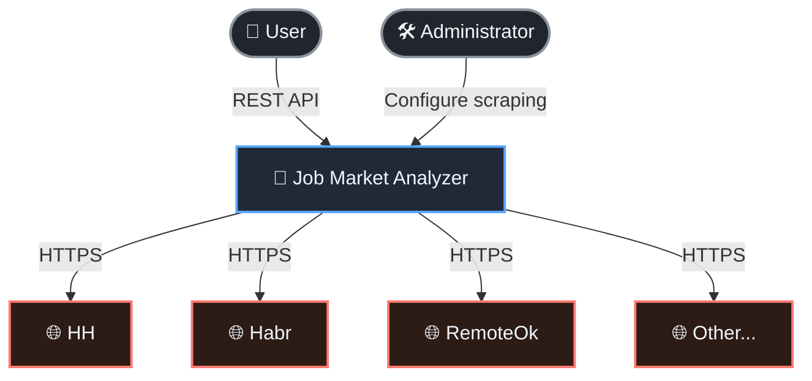
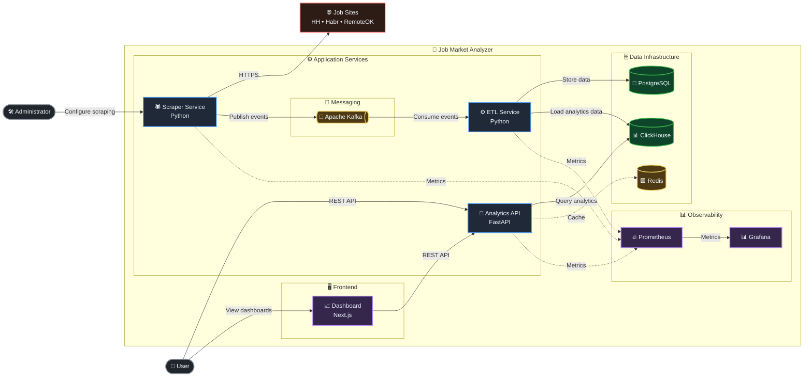

# Job Market Analyzer — Architecture Overview

## Purpose

Job Market Analyzer is a microservice-based platform for collecting, processing and analyzing job market data from multiple job websites.

The system periodically collects job vacancies, normalizes and validates the data, stores it in PostgreSQL and exposes analytical information through a REST API and a web dashboard.

---

## Goals

The main goals of the project are:

* Collect vacancies from multiple job platforms.
* Normalize heterogeneous data into a unified model.
* Store historical vacancy information.
* Analyze salaries, technologies, companies and locations.
* Provide analytical data through REST API.
* Demonstrate a production-like microservice architecture using Python.

---

## Scope

The project consists of three independent microservices:

* **Scraper Service** — collects vacancies from external job websites.
* **ETL Service** — validates, transforms and stores collected data.
* **Analytics Service** — provides analytical data through REST API.

Shared infrastructure:

* PostgreSQL
* Redis

---

## High-Level Architecture

The system communicates with external job websites, processes collected data through an asynchronous pipeline and stores normalized information in PostgreSQL. Users interact with the platform through the Analytics API and the dashboard.

---

## Containers

The application is divided into independent services.

| Service           | Responsibility                           |
| ----------------- | ---------------------------------------- |
| Scraper Service   | Collects vacancy data                    |
| ETL Service       | Processes and stores data                |
| Analytics Service | Provides REST API and analytical queries |

Infrastructure:

* PostgreSQL — primary data storage.
* ClickHouse — analytics data storage.
* Redis — cache.
* Kafka — message broker.
* Prometheus — collects metrics
* Grafana — metrics analytics 

---

## Components

Each microservice is further divided into internal components.

* Scraper Service → Scheduler, Coordinator, Parsers, Normalization Layer.
* ETL Service → Consumer, Validation, Transformation, Persistence.
* Analytics Service → API Layer, Analytics Engine, Persistence Layer.

Detailed component diagrams are available in the `docs/diagrams` directory.

---

## Data Flow

The data processing pipeline consists of the following stages:

1. Scheduler starts the scraping process.
2. Scraper downloads vacancies from job websites.
3. Parsed data is converted into a common DTO.
4. DTO objects are published to Redis.
5. ETL consumes messages from Redis.
6. Data is validated and transformed.
7. Processed data is stored in PostgreSQL.
8. Analytics Service queries the database and cache.
9. Dashboard displays analytical information.

See the Sequence Diagram and Data Flow documentation for more details.

---

## Technology Stack

### Backend

* Python
* FastAPI
* SQLAlchemy
* Alembic

### Infrastructure

* PostgreSQL
* Redis
* Docker
* Docker Compose

### Testing

* pytest
* pytest-asyncio

### Development

* Ruff
* MyPy
* pre-commit

---

## Documentation Structure

| Document                   | Description                   |
| -------------------------- | ----------------------------- |
| architecture/services.md   | Service responsibilities      |
| architecture/data-flow.md  | Data processing pipeline      |
| architecture/deployment.md | Deployment architecture       |
| database/schema.md         | Database design               |
| database/redis.md          | Redis keys and queues         |
| api/openapi.md             | REST API documentation        |
| testing/strategy.md        | Testing strategy              |
| adr/                       | Architecture Decision Records |

---

## Design Principles

The architecture follows several principles:

* Separation of responsibilities.
* Independent deployable services.
* Asynchronous data processing.
* Stateless services where possible.
* Strong typing.
* Testability.
* Containerized deployment.
* Clear service boundaries.