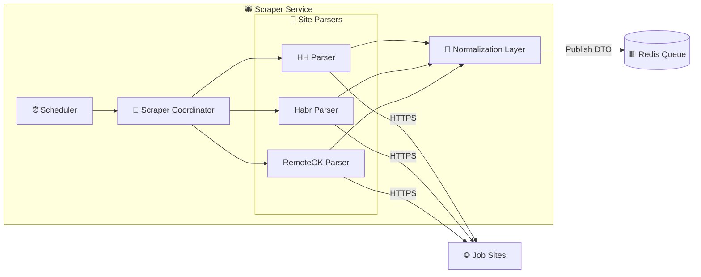

# Scraper Service

## Purpose

Scraper Service is responsible for collecting vacancy data from external job boards.

The service periodically requests vacancy pages, parses HTML or JSON responses,
normalizes extracted data into a common DTO and publishes messages to Redis.

---

## Responsibilities

- Schedule scraping jobs
- Download vacancy pages
- Parse source-specific data
- Normalize vacancies
- Handle retries
- Publish VacancyDTO to Redis
- Log scraping statistics

---

## Does NOT

- Store data in PostgreSQL
- Perform analytics
- Transform business data

## C3 components

