# Job Market Analyzer — Development Roadmap

> Production-style roadmap for a Python microservices platform for collecting, processing and analyzing job market data.

---

# Table of Contents

* [Project Vision](#project-vision)
* [Goals](#goals)
* [Technology Stack](#technology-stack)
* [High-Level Architecture](#high-level-architecture)
* [Development Philosophy](#development-philosophy)
* [Repository Structure](#repository-structure)
* [Milestones](#milestones)
* [Phase 1 — Architecture & Planning](#phase-1--architecture--planning)
* [Phase 2 — Repository Initialization](#phase-2--repository-initialization)
* [Phase 3 — Documentation Foundation](#phase-3--documentation-foundation)
* [Phase 4 — Infrastructure Bootstrap](#phase-4--infrastructure-bootstrap)

---

# Project Vision

Build a **production-inspired microservices platform** that continuously collects job vacancies from multiple sources, transforms and enriches the data through ETL pipelines, stores both operational and analytical datasets, and exposes aggregated insights through a REST API and dashboard.

The project is designed to demonstrate experience with:

* Python backend development
* Microservices architecture
* Event-driven communication
* ETL pipelines
* PostgreSQL schema design
* Analytical databases
* Docker-based infrastructure
* Monitoring and observability
* CI/CD automation

This repository should be suitable for:

* portfolio presentation;
* technical interviews;
* backend engineering practice;
* data engineering learning;
* system design discussions.

---

# Goals

## Functional Goals

* Collect vacancies from multiple job sources.
* Normalize and enrich raw vacancy data.
* Store operational data in PostgreSQL.
* Store analytical datasets in ClickHouse.
* Provide analytical reports and statistics.
* Expose a REST API for external consumers.
* Visualize trends in a web dashboard.

## Non-Functional Goals

* Containerized deployment.
* Independent service scaling.
* Fault-tolerant message processing.
* Reproducible local environment.
* Structured logging and monitoring.
* Automated testing and CI/CD.

---

# Technology Stack

## Core Backend

| Technology        | Purpose                     |
| ----------------- | --------------------------- |
| Python 3.13+      | Main programming language   |
| FastAPI           | REST APIs and microservices |
| SQLAlchemy 2.0    | ORM and database access     |
| Alembic           | Database migrations         |
| Pydantic Settings | Configuration management    |

## Data Layer

| Technology | Purpose                     |
| ---------- | --------------------------- |
| PostgreSQL | Operational storage         |
| ClickHouse | Analytical storage          |
| Redis      | Caching and temporary state |

## Messaging

| Technology   | Purpose                          |
| ------------ | -------------------------------- |
| Apache Kafka | Event streaming between services |

## ETL & Analytics

| Technology | Purpose                                |
| ---------- | -------------------------------------- |
| Pandas     | Data transformation                    |
| Polars     | High-performance analytical processing |

## Infrastructure

| Technology     | Purpose             |
| -------------- | ------------------- |
| Docker         | Containerization    |
| Docker Compose | Local orchestration |

## Observability

| Technology | Purpose                      |
| ---------- | ---------------------------- |
| Prometheus | Metrics collection           |
| Grafana    | Dashboards and visualization |

## Quality Assurance

| Technology | Purpose              |
| ---------- | -------------------- |
| Pytest     | Testing framework    |
| Ruff       | Linting              |
| Black      | Code formatting      |
| MyPy       | Static type checking |
| pre-commit | Local quality gates  |

## CI/CD

| Technology     | Purpose             |
| -------------- | ------------------- |
| GitHub Actions | Automated pipelines |

---

# High-Level Architecture

```mermaid
%%{
init: {
  "theme": "base",
  "themeVariables": {
    "background": "#0D1117",
    "primaryColor": "#1F2937",
    "primaryBorderColor": "#58A6FF",
    "primaryTextColor": "#F0F6FC",
    "secondaryColor": "#161B22",
    "secondaryBorderColor": "#7EE787",
    "secondaryTextColor": "#F0F6FC",
    "tertiaryColor": "#21262D",
    "tertiaryBorderColor": "#D2A8FF",
    "tertiaryTextColor": "#F0F6FC",
    "lineColor": "#8B949E",
    "clusterBkg": "#161B22",
    "clusterBorder": "#30363D",
    "edgeLabelBackground": "#0D1117",
    "fontFamily": "Inter, Segoe UI, Arial",
    "fontSize": "15px"
  },
  "flowchart": {
    "curve": "basis",
    "nodeSpacing": 60,
    "rankSpacing": 80,
    "padding": 10,
    "htmlLabels": true
  }
}
}%%

flowchart LR

scheduler["⏰ Scheduler"]
scraper["🕷️ Scraper Service"]
kafka["📨 Apache Kafka"]
etl["⚙️ ETL Service"]
postgres[("🐘 PostgreSQL")]
clickhouse[("📊 ClickHouse")]
analytics["📈 Analytics Service"]
redis[("🟥 Redis Cache")]
api["🚀 REST API"]
dashboard["💻 Dashboard"]

scheduler --> scraper
scraper --> kafka
kafka --> etl
etl --> postgres
etl --> clickhouse
postgres --> analytics
clickhouse --> analytics
analytics --> redis
redis --> api
api --> dashboard

classDef service fill:#1F2937,stroke:#58A6FF,stroke-width:2px,color:#F0F6FC;
classDef database fill:#0E4429,stroke:#3FB950,stroke-width:2px,color:#F0F6FC;
classDef cache fill:#4D3A12,stroke:#F2CC60,stroke-width:2px,color:#F0F6FC;
classDef queue fill:#4D3A12,stroke:#F2CC60,stroke-width:2px,color:#F0F6FC;
classDef dashboard fill:#35264C,stroke:#BC8CFF,stroke-width:2px,color:#F0F6FC;
classDef scheduler fill:#3A2F00,stroke:#D29922,stroke-width:2px,color:#F0F6FC;

class scheduler scheduler
class scraper,etl,analytics,api service
class postgres,clickhouse database
class kafka queue
class redis cache
class dashboard dashboard
```

---

# Development Philosophy

The project follows several architectural principles.

## Service Isolation

Each microservice owns its own business responsibility:

* **Scraper** — data collection;
* **ETL** — transformation and enrichment;
* **Analytics** — aggregation and reporting;
* **API** — external access;
* **Scheduler** — orchestration.

## Event-Driven Communication

Services communicate asynchronously through Kafka events rather than direct synchronous calls whenever possible.

## Shared Infrastructure, Not Shared Business Logic

Reusable utilities may live in `shared/`, but domain logic should remain inside the owning service.

## Documentation First

Every significant architectural decision should be documented before implementation.

---

# Repository Structure

```text
job-market-analyzer/
│
├── docs/
│   ├── architecture/
│   ├── database/
│   ├── api/
│   ├── development/
│   └── diagrams/
│
├── services/
│   ├── scraper/
│   ├── etl/
│   ├── analytics/
│   ├── api/
│   └── scheduler/
│
├── shared/
│   ├── config/
│   ├── database/
│   ├── events/
│   ├── logging/
│   └── schemas/
│
├── infrastructure/
│   ├── docker/
│   ├── postgres/
│   ├── redis/
│   ├── kafka/
│   ├── clickhouse/
│   └── monitoring/
│
├── .env.example
├── docker-compose.yml
├── pyproject.toml
├── Makefile
└── README.md
```

---

# Milestones

| Milestone | Status | Goal                      |
| --------- | ------ | ------------------------- |
| M1        | ⬜      | Architecture & Planning   |
| M2        | ⬜      | Repository Initialization |
| M3        | ⬜      | Documentation Foundation  |
| M4        | ⬜      | Infrastructure Bootstrap  |
| M5        | ⬜      | Shared Library            |
| M6        | ⬜      | PostgreSQL Schema         |
| M7        | ⬜      | Kafka Integration         |
| M8        | ⬜      | Scraper Service           |
| M9        | ⬜      | ETL Service               |
| M10       | ⬜      | Analytics Service         |
| M11       | ⬜      | Redis Caching             |
| M12       | ⬜      | REST API                  |
| M13       | ⬜      | Dashboard                 |
| M14       | ⬜      | Monitoring                |
| M15       | ⬜      | Testing                   |
| M16       | ⬜      | CI/CD                     |
| M17       | ⬜      | Production Readiness      |

---

# Phase 1 — Architecture & Planning

## Objectives

* Define system boundaries.
* Identify external dependencies.
* Choose communication patterns.
* Design the initial data model.
* Establish coding standards.

## Tasks

### Functional Requirements

* Vacancy collection
* Salary normalization
* Skill extraction
* Trend analytics
* Public API
* Dashboard visualization

### Non-Functional Requirements

* Scalability
* Reliability
* Observability
* Testability
* Reproducibility

### Deliverables

* Architecture diagrams
* Initial ER model
* Technology decision records
* Development conventions

## Definition of Done

* [ ] Architecture approved
* [ ] Service boundaries documented
* [ ] Initial diagrams created
* [ ] Technology stack finalized

---

# Phase 2 — Repository Initialization

## Objectives

Prepare a clean and maintainable repository structure.

## Tasks

### Initialize Git Repository

```bash
git init
```

### Create Base Files

```text
.gitignore
.editorconfig
.env.example
README.md
LICENSE
pyproject.toml
```

### Configure Python Tooling

* Ruff
* Black
* MyPy
* Pytest
* pre-commit

## Recommended `pyproject.toml` Sections

* `[tool.ruff]`
* `[tool.black]`
* `[tool.mypy]`
* `[tool.pytest.ini_options]`

## Definition of Done

* [ ] Repository initialized
* [ ] Python tooling configured
* [ ] Pre-commit hooks installed
* [ ] Basic README created

---

# Phase 3 — Documentation Foundation

## Objectives

Create production-style project documentation from the beginning.

## Documentation Structure

```text
docs/
├── architecture/
├── database/
├── api/
├── development/
└── diagrams/
```

## Required Documents

| Document         | Purpose                       |
| ---------------- | ----------------------------- |
| `overview.md`    | High-level system description |
| `services.md`    | Service responsibilities      |
| `schema.md`      | Database documentation        |
| `roadmap.md`     | Development plan              |
| `conventions.md` | Coding standards              |
| `docker.md`      | Local environment setup       |

## Architecture Documentation Flow

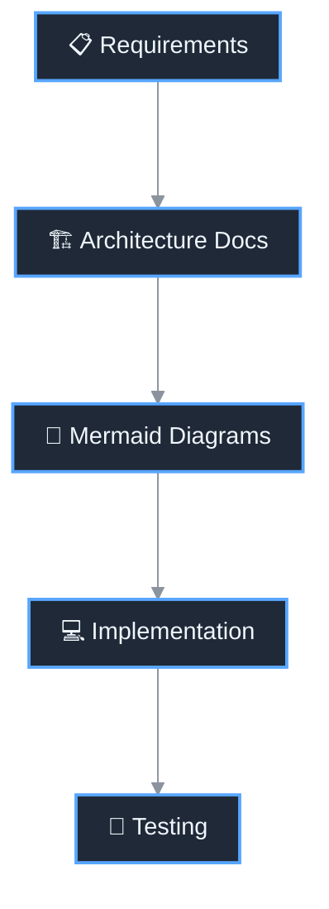

## Definition of Done

* [ ] Documentation folders created
* [ ] Core markdown files added
* [ ] Mermaid rendering verified in GitHub and VS Code
* [ ] Documentation navigation established

---

# Phase 4 — Infrastructure Bootstrap

## Objectives

Create a fully reproducible local development environment using Docker Compose.

## Services to Run

| Service    | Purpose                   |
| ---------- | ------------------------- |
| PostgreSQL | Operational database      |
| Redis      | Cache and temporary state |
| Kafka      | Event streaming           |
| Kafka UI   | Topic inspection          |
| ClickHouse | Analytical database       |
| Prometheus | Metrics collection        |
| Grafana    | Monitoring dashboards     |

## Infrastructure Diagram

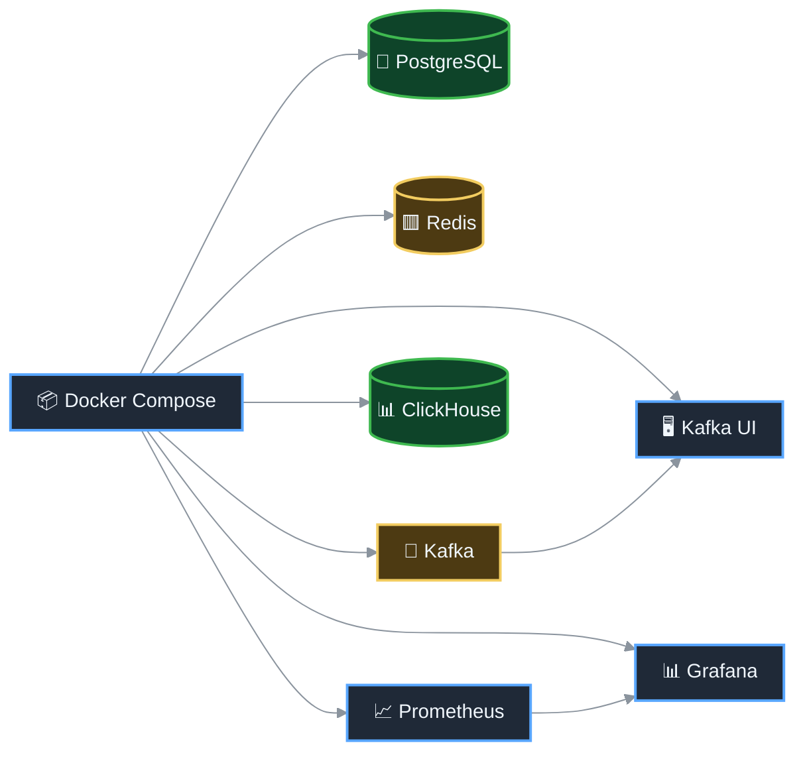

## Docker Compose Responsibilities

### PostgreSQL

* Persistent volume
* Healthcheck
* UTF-8 locale
* Dedicated application database

### Kafka

* Single-node KRaft mode for development
* Internal Docker network listener
* External localhost listener for debugging

### ClickHouse

* Persistent storage
* HTTP interface enabled
* Native TCP protocol enabled

### Prometheus & Grafana

* Preconfigured datasource
* Version-controlled dashboards
* Metrics scraping from all services

## Startup Verification Checklist

After running:

```bash
docker compose up -d
```

Verify:

* [ ] PostgreSQL accepts connections
* [ ] Redis responds to `PING`
* [ ] Kafka broker is healthy
* [ ] Kafka UI is accessible
* [ ] ClickHouse HTTP endpoint works
* [ ] Prometheus targets are up
* [ ] Grafana dashboard loads

## Definition of Done

* [ ] `docker compose up` starts all infrastructure services
* [ ] All containers have healthchecks
* [ ] Data persists across restarts
* [ ] Internal Docker network is configured
* [ ] Environment variables are documented

---

# Current Progress

| Phase                        | Status         |
| ---------------------------- | -------------- |
| 1. Architecture & Planning   | 🟡 In Progress |
| 2. Repository Initialization | 🟡 In Progress |
| 3. Documentation Foundation  | 🟡 In Progress |
| 4. Infrastructure Bootstrap  | 🟡 In Progress |
| 5. Shared Library            | ⬜ Pending      |
| 6. PostgreSQL Schema         | ⬜ Pending      |
| 7. Kafka Integration         | ⬜ Pending      |
| 8. Scraper Service           | ⬜ Pending      |
| 9. ETL Service               | ⬜ Pending      |
| 10. Analytics Service        | ⬜ Pending      |
| 11. Redis Caching            | ⬜ Pending      |
| 12. REST API                 | ⬜ Pending      |
| 13. Dashboard                | ⬜ Pending      |
| 14. Monitoring               | ⬜ Pending      |
| 15. Testing                  | ⬜ Pending      |
| 16. CI/CD                    | ⬜ Pending      |
| 17. Production Readiness     | ⬜ Pending      |

---

# Next Section

The next update of `roadmap.md` should include:

1. **Phase 5 — Shared Library**
2. **Phase 6 — PostgreSQL Schema Design**
3. **ER Diagram (Mermaid)**
4. **Alembic Migration Strategy**
5. **Kafka Topic Design**
6. **Event Contracts**
7. **Data Validation Pipeline**

These sections will establish the **core data model and communication contracts** for all microservices in the platform.

---

# Phase 5 — Shared Library

## Overview

All microservices should remain independent, but infrastructure-related code should not be duplicated.

The `shared` package contains reusable components used across all services.

Business logic **must never** be placed inside `shared`.

Only common infrastructure belongs here.

---

## Responsibilities

The shared package is responsible for:

- configuration
- logging
- Kafka clients
- Redis client
- PostgreSQL client
- shared schemas
- common exceptions
- utilities
- event contracts

---

## Directory Structure

```text
shared/
│
├── config/
│   ├── settings.py
│   └── environments.py
│
├── database/
│   ├── postgres.py
│   ├── clickhouse.py
│   └── session.py
│
├── cache/
│   └── redis.py
│
├── messaging/
│   ├── producer.py
│   ├── consumer.py
│   └── topics.py
│
├── schemas/
│   ├── vacancy.py
│   ├── company.py
│   └── salary.py
│
├── events/
│   ├── vacancy_created.py
│   ├── vacancy_normalized.py
│   └── analytics_updated.py
│
├── logging/
│   └── logger.py
│
└── utils/
```

---

## Shared Library Architecture

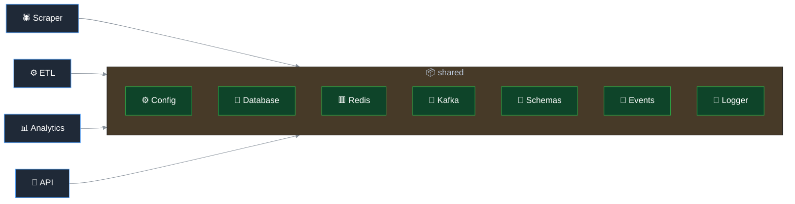

---

## Definition of Done

- [ ] Shared package created
- [ ] Configuration reusable
- [ ] Logger reusable
- [ ] Kafka client reusable
- [ ] Redis client reusable
- [ ] PostgreSQL client reusable

---

# Phase 6 — Database Design

## Overview

Two databases will be used.

| Database | Purpose |
|-----------|---------|
| PostgreSQL | Operational storage |
| ClickHouse | Analytical storage |

PostgreSQL stores normalized entities.

ClickHouse stores analytical datasets optimized for aggregation.

---

## PostgreSQL Domain Model

Main entities:

- Vacancy
- Company
- Skill
- City
- Source
- Salary

---

## Entity Relationship Diagram

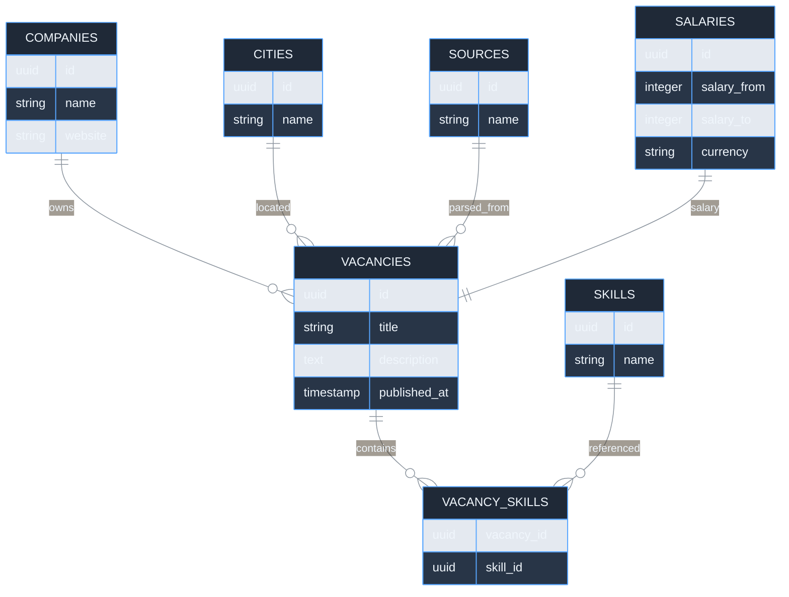

---

## Database Schema

### companies

Stores employer information.

Fields:

- id
- name
- website
- created_at

---

### vacancies

Stores normalized vacancies.

Fields:

- id
- company_id
- city_id
- source_id
- salary_id
- title
- description
- url
- experience
- employment
- published_at
- created_at

---

### skills

Unique skills.

Examples

- Python
- Docker
- FastAPI
- Kafka
- Redis

---

### vacancy_skills

Many-to-many relation.

---

### cities

Dictionary.

---

### sources

Job websites.

Examples

- HH
- Habr Career
- RemoteOK

---

### salaries

Normalized salary information.

Supports:

- currency
- salary_from
- salary_to
- gross/net

---

## Database Lifecycle

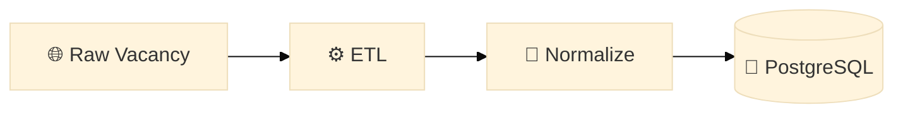

---

## Migration Strategy

Alembic will be used.

Migration rules:

- one feature = one migration
- never edit old migrations
- use downgrade()
- keep migrations deterministic

Example

```
001_create_companies

002_create_vacancies

003_create_skills

004_create_salary

005_add_indexes
```

---

## Index Strategy

Indexes:

Vacancies

- published_at
- company_id
- city_id
- experience

Skills

- name

Companies

- name

Sources

- name

---

## Definition of Done

- [ ] ER diagram completed
- [ ] Alembic initialized
- [ ] First migration created
- [ ] Indexes documented
- [ ] Naming convention documented

---

# Phase 7 — Event-Driven Architecture

## Overview

Microservices should communicate asynchronously.

The platform uses **Apache Kafka** as the central event streaming platform.

Each service is responsible only for producing and consuming specific events.

No service should directly call another service unless absolutely necessary.

This architecture provides:

- loose coupling
- scalability
- fault tolerance
- independent deployments
- horizontal scaling

---

# Why Kafka?

Kafka was selected because it provides:

- persistent event log
- event replay
- multiple consumers
- consumer groups
- high throughput
- partitioning
- ordering inside partitions

Unlike traditional message queues, Kafka allows multiple independent services to consume the same event stream.

---

# Architecture

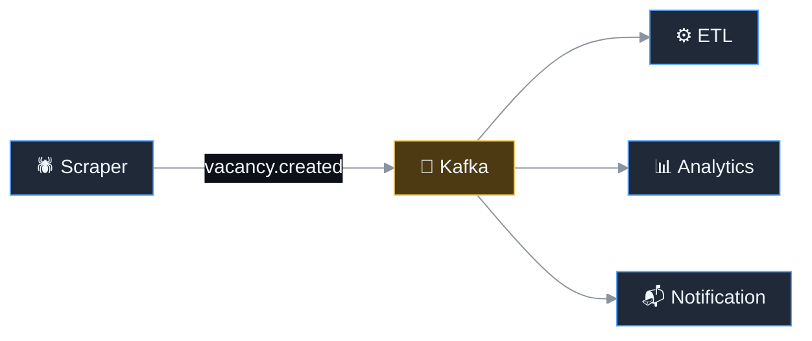

---

# Kafka Topics

The initial version of the platform contains the following topics.

| Topic | Producer | Consumer |
|---------|----------|-----------|
| vacancy.raw | Scraper | ETL |
| vacancy.normalized | ETL | Analytics |
| analytics.updated | Analytics | API |
| system.logs | All services | Monitoring |

---

# Topic Naming Convention

```
domain.action
```

Examples

```
vacancy.raw

vacancy.normalized

analytics.updated

system.logs
```

Avoid names like

```
topic1

queue

messages

etl-data
```

---

# Event Lifecycle

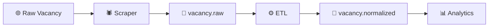

---

# Event Contracts

Every Kafka message must follow a common schema.

```json
{
    "event_id": "...",
    "event_type": "...",
    "version": 1,
    "timestamp": "...",
    "payload": {}
}
```

---

# Example Event

```json
{
  "event_id": "3bce6c0e",

  "event_type": "vacancy.created",

  "version": 1,

  "timestamp": "2026-08-06T13:42:11Z",

  "payload": {

      "source":"hh",

      "vacancy_id":"12345",

      "url":"https://hh.ru/vacancy/12345"

  }

}
```

---

# Event Versioning

Future schema changes should never break existing consumers.

Rules

- always increase version
- never remove fields
- add optional fields only
- support backward compatibility

---

# Producer Responsibilities

Every producer should:

- validate outgoing messages
- serialize JSON
- log publishing
- retry temporary failures
- publish only valid events

---

# Consumer Responsibilities

Consumers should

- validate schema

- deserialize event

- process business logic

- acknowledge successful processing

- send failed messages to DLQ

---

# Consumer Groups

Each service has its own consumer group.

Example

| Service | Consumer Group |
|-----------|----------------|
| ETL | etl-group |
| Analytics | analytics-group |
| Notification | notification-group |

This allows services to process the same event independently.

---

# Retry Strategy

Temporary failures should not lose data.

Retry policy

Attempt

1

↓

2 seconds

↓

Attempt

2

↓

5 seconds

↓

Attempt

3

↓

10 seconds

↓

Dead Letter Queue

---

# Dead Letter Queue

Messages that cannot be processed after several retries are redirected to

```
vacancy.dlq
```

Reasons:

- malformed JSON

- validation failure

- unexpected exception

- unsupported schema version

DLQ should be monitored continuously.

---

# Sequence Diagram

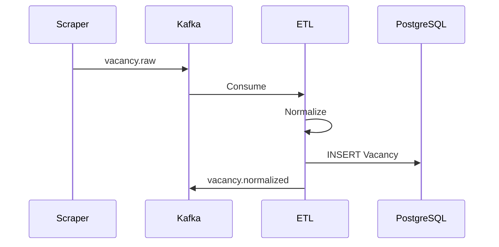

---

# Delivery Guarantees

Target guarantee

At-Least-Once

Duplicate processing must be handled by ETL.

Never rely on Exactly Once semantics inside business logic.

---

# Idempotency

The ETL service should safely process duplicate events.

Possible approaches

- unique constraints

- UPSERT

- event_id table

- checksum

---

# Partitioning Strategy

Partition key

```
vacancy_id
```

Advantages

- stable ordering

- predictable distribution

- easier debugging

---

# Monitoring

Kafka metrics

- broker health

- consumer lag

- publish rate

- failed messages

- retry count

- DLQ size

---

# Definition of Done

- [ ] Kafka running in Docker
- [ ] Topics created
- [ ] Producer implemented
- [ ] Consumer implemented
- [ ] Retry policy documented
- [ ] DLQ configured
- [ ] Event contracts documented
- [ ] Sequence diagrams completed

---

# Phase 8 — Scraper Service

## Overview

The Scraper Service is responsible for collecting raw vacancy data from external job platforms.

It **does not** perform:

- salary normalization
- duplicate detection
- skill extraction
- analytics
- database writes

Its only responsibility is collecting data and publishing raw events to Kafka.

---

## Responsibilities

- Connect to external APIs
- Parse raw vacancies
- Handle pagination
- Respect rate limits
- Retry failed requests
- Validate response format
- Publish events

---

## Supported Sources

| Source | Status |
|---------|--------|
| HH API | ✅ |
| Habr Career | 🔜 |
| RemoteOK | 🔜 |
| LinkedIn | ❌ (API restrictions) |

---

## Service Architecture

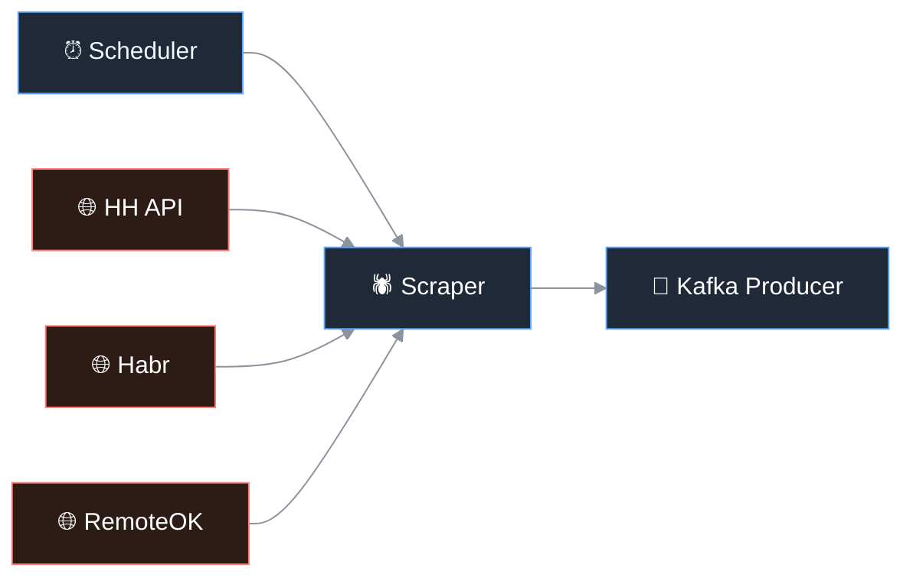

---

## Directory Structure

```text
scraper/

app/

api/

clients/

parsers/

producer/

scheduler/

schemas/

config/

main.py
```

---

## Internal Modules

### clients/

Responsible for HTTP communication.

Example

```
HHClient

RemoteOKClient

HabrClient
```

---

### parsers/

Converts raw API responses into internal schemas.

---

### producer/

Publishes validated events to Kafka.

---

### scheduler/

Starts scraping jobs.

---

## Request Lifecycle

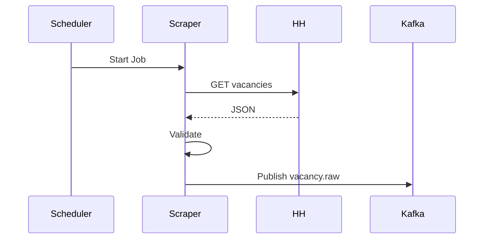

---

## Retry Strategy

Retry on:

- timeout
- HTTP 429
- temporary network failures
- HTTP 500

Do not retry:

- HTTP 404
- invalid request
- malformed configuration

---

## Rate Limiting

Every provider has different limits.

The scraper should include:

- request delay

- exponential backoff

- configurable concurrency

---

## Logging

Every request should log:

- provider

- endpoint

- response time

- status code

- number of vacancies

---

## Metrics

Prometheus metrics

- requests_total

- failed_requests

- vacancies_scraped

- scrape_duration

---

## Deliverables

- HTTP client
- Provider abstraction
- Kafka producer
- Scheduler
- Healthcheck
- Dockerfile

---

## Definition of Done

- [ ] HH API integrated
- [ ] Pagination works
- [ ] Retry implemented
- [ ] Rate limiting works
- [ ] Kafka publishing works
- [ ] Metrics exported
- [ ] Health endpoint added

---

# Phase 9 — ETL Service

## Overview

The ETL Service receives raw events from Kafka and transforms them into normalized business entities.

This service owns all data transformation logic.

---

## Responsibilities

- Validate incoming events
- Normalize salaries
- Normalize currencies
- Detect skills
- Remove duplicates
- Resolve company
- Resolve city
- Store data

---

## ETL Pipeline

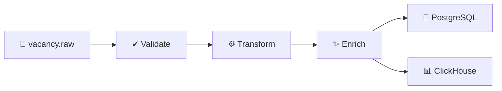

---

## Directory Structure

```text
etl/

app/

consumer/

validators/

transformers/

enrichers/

repositories/

services/

config/

main.py
```

---

## Processing Steps

### 1. Validation

Validate:

- schema
- required fields
- provider

---

### 2. Normalization

Convert

```
$1000

↓

RUB
```

Normalize

- currency
- salary range
- employment type
- experience level

---

### 3. Enrichment

Extract

- skills
- technologies
- frameworks
- programming languages

Resolve

- company
- city
- source

---

### 4. Deduplication

Duplicate detection should compare

- provider id
- URL
- checksum
- title + company

---

### 5. Database Write

Insert

- company
- city
- vacancy
- salary
- vacancy_skills

---

## Processing Flow

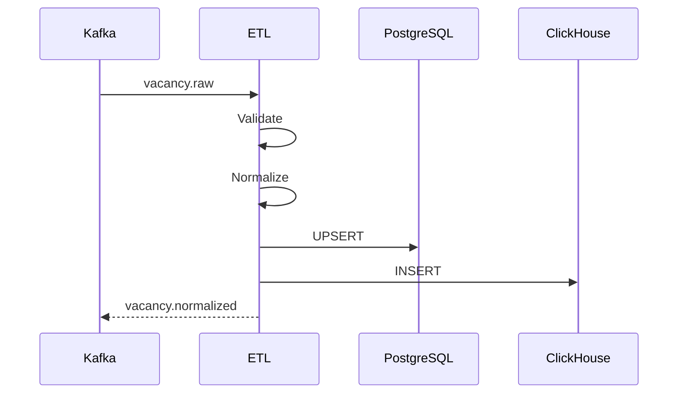

---

## Error Handling

Errors are classified into

Recoverable

- timeout
- database unavailable
- temporary connection issues

Fatal

- invalid schema
- missing mandatory fields
- unsupported version

---

## Idempotency

Processing the same event twice should never create duplicated rows.

Possible techniques

- UPSERT

- UNIQUE constraints

- event hash

---

## Metrics

Prometheus

- processed_events

- failed_events

- duplicates

- processing_time

---

## Deliverables

- Kafka Consumer
- Validation
- Transformation
- Enrichment
- PostgreSQL Loader
- ClickHouse Loader
- Metrics

---

## Definition of Done

- [ ] Consumes Kafka events
- [ ] Normalizes salaries
- [ ] Detects skills
- [ ] Removes duplicates
- [ ] Writes PostgreSQL
- [ ] Writes ClickHouse
- [ ] Publishes normalized events


---

# Phase 10 — Analytics Service

## Overview

The Analytics Service transforms normalized vacancy data into business metrics.

Unlike the ETL Service, it **does not modify operational data**.

Its responsibility is to aggregate, calculate and cache analytical information.

---

## Responsibilities

- Calculate statistics
- Aggregate salary data
- Analyze technologies
- Build historical trends
- Generate dashboards
- Cache expensive queries
- Publish analytics updates

---

## Data Sources

| Source | Purpose |
|----------|---------|
| PostgreSQL | Operational queries |
| ClickHouse | Analytical queries |
| Redis | Cache |

---

## Service Architecture

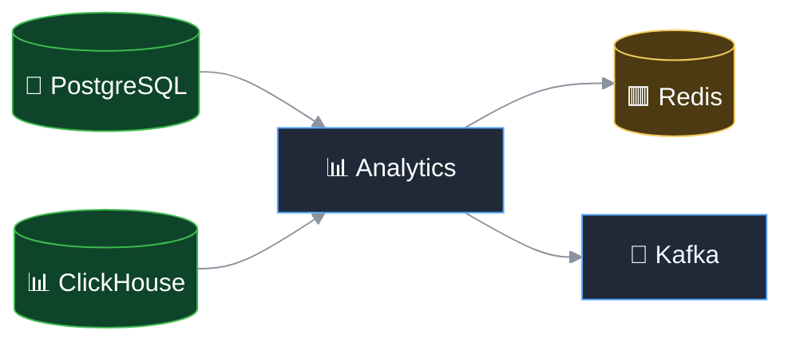

---

## Supported Analytics

Salary

- average salary
- median salary
- salary distribution

Technologies

- most popular skills
- skill growth
- framework popularity

Locations

- vacancies by city
- average salary by city

Companies

- top hiring companies
- vacancies by employer

Time

- vacancies per day
- vacancies per month
- hiring trends

---

## Cache Strategy

Frequently requested reports should be cached.

Examples

```
top_skills

salary_by_city

salary_by_language

top_companies
```

---

## Redis Keys

```
analytics:skills

analytics:salary

analytics:cities

analytics:companies

analytics:dashboard
```

TTL

```
10 minutes
```

---

## Aggregation Pipeline

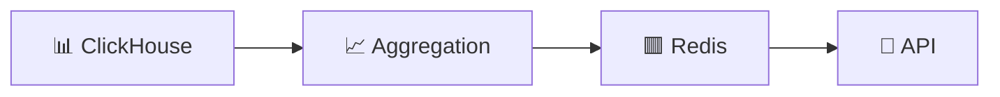

---

## Metrics

Prometheus

- cache_hits
- cache_misses
- query_duration
- reports_generated

---

## Deliverables

- Aggregation engine
- Redis cache
- Statistics module
- Trend calculator
- Kafka producer

---

## Definition of Done

- [ ] Salary reports
- [ ] Skill reports
- [ ] Company reports
- [ ] Redis caching
- [ ] Kafka publishing

---

# Phase 11 — REST API

## Overview

The API Service is the public entry point into the platform.

It exposes analytical data without exposing internal services.

Only this service is accessible from outside the Docker network.

---

## Responsibilities

- Authentication
- Authorization
- Request validation
- Cache access
- Database queries
- Response serialization

---

## Architecture

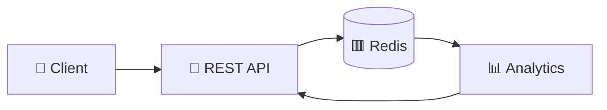

---

## Endpoints

### Health

```
GET /health
```

---

### Statistics

```
GET /analytics/salary

GET /analytics/skills

GET /analytics/cities

GET /analytics/companies
```

---

### Vacancy Search

```
GET /vacancies
```

Parameters

- city
- salary_from
- salary_to
- company
- technology
- employment
- experience

---

### Technologies

```
GET /skills
```

---

### Companies

```
GET /companies
```

---

## API Principles

- RESTful
- JSON only
- Pagination
- Filtering
- Validation
- OpenAPI

---

## Validation

Pydantic models

Example

```
SalaryFilter

TechnologyFilter

CityFilter

Pagination
```

---

## Error Format

```json
{
    "error":"Validation Error",

    "message":"salary_from must be positive"
}
```

---

## Metrics

- request_count

- response_time

- error_rate

- cache_hit_rate

---

## Deliverables

- FastAPI application
- OpenAPI
- Validation
- Pagination
- Healthcheck

---

## Definition of Done

- [ ] OpenAPI generated
- [ ] Filtering works
- [ ] Pagination works
- [ ] Health endpoint
- [ ] Metrics endpoint

---

# Phase 12 — Dashboard

## Overview

The Dashboard visualizes analytical data collected by the platform.

Initially it will consume the REST API.

Future versions may support WebSocket updates.

---

## Technology

Recommended

- React
- TypeScript
- Vite
- TailwindCSS
- Recharts

---

## Pages

Dashboard

Salary Analytics

Technology Trends

Companies

Cities

Search

System Health

---

## Dashboard Architecture

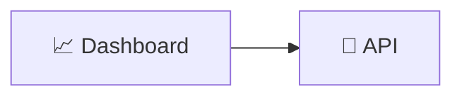

---

## Widgets

Salary

- average
- median
- histogram

Technologies

- top skills
- trend chart

Companies

- top employers

Cities

- heatmap

System

- uptime
- Kafka health
- PostgreSQL health

---

## Charts

- Bar Chart
- Pie Chart
- Line Chart
- Heatmap
- Area Chart

---

## Deliverables

- Dashboard layout
- API integration
- Charts
- Filters
- Search

---

## Definition of Done

- [ ] Dashboard created
- [ ] Charts work
- [ ] API connected
- [ ] Responsive layout
- [ ] Error handling

---

---

# Phase 13 — Monitoring & Observability

## Overview

Monitoring is essential for understanding the health, performance and reliability of the platform.

Every service must expose metrics and structured logs.

The monitoring stack should provide visibility into:

- infrastructure
- services
- databases
- message broker
- ETL pipeline
- API performance

---

## Monitoring Stack

| Component | Technology |
|-----------|------------|
| Metrics | Prometheus |
| Dashboards | Grafana |
| Logs | Structlog + Docker Logs |
| Health Checks | FastAPI Health Endpoint |

---

## Metrics Architecture

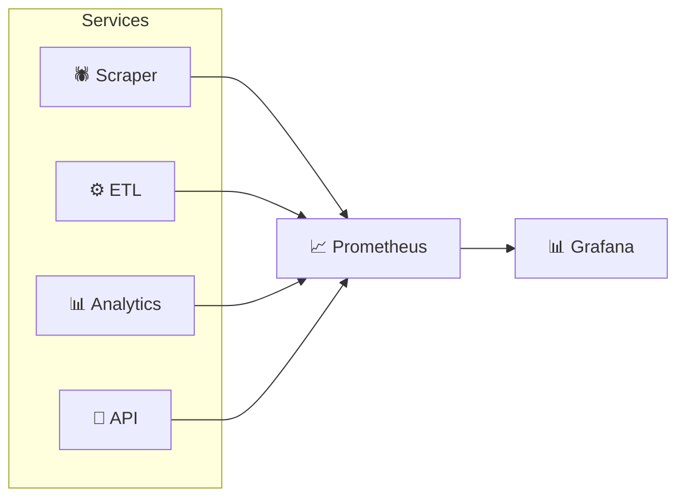

---

## Health Endpoints

Every service must expose

```
GET /health
```

Response

```json
{
    "status":"healthy"
}
```

---

## Metrics

### Scraper

- scrape_jobs_total
- requests_total
- failed_requests
- scrape_duration_seconds

---

### ETL

- processed_events_total
- failed_events_total
- duplicate_events_total

---

### Analytics

- reports_generated
- cache_hits
- cache_misses

---

### API

- requests_total
- latency_seconds
- active_requests
- http_errors_total

---

## Logging

All services use structured JSON logging.

Required fields

- timestamp
- level
- service
- trace_id
- event
- message

---

## Deliverables

- Prometheus
- Grafana
- Dashboards
- Health checks
- Metrics

---

## Definition of Done

- [ ] Metrics exported
- [ ] Grafana dashboards created
- [ ] Health endpoints implemented
- [ ] Structured logging enabled

---

# Phase 14 — Testing Strategy

## Objectives

Every service should be independently testable.

Testing pyramid

```
             E2E

      Integration

         Unit Tests
```

---

## Test Types

### Unit Tests

Framework

```
pytest
```

Coverage

- business logic
- transformers
- validators
- repositories

---

### Integration Tests

Verify

- PostgreSQL

- Redis

- Kafka

- ClickHouse

---

### API Tests

Test

- HTTP status

- validation

- pagination

- filtering

---

### End-to-End Tests

Scenario

Scheduler

↓

Scraper

↓

Kafka

↓

ETL

↓

PostgreSQL

↓

Analytics

↓

API

↓

Dashboard

---

## Coverage Goal

Target

```
80%+
```

Critical modules

```
95%+
```

---

## Deliverables

- pytest
- fixtures
- dockerized tests
- CI integration

---

## Definition of Done

- [ ] Unit tests
- [ ] Integration tests
- [ ] API tests
- [ ] End-to-End tests
- [ ] Coverage report

---

# Phase 15 — CI/CD

## Objectives

Every commit should automatically verify project quality.

---

## GitHub Actions Pipeline

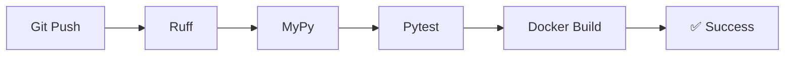

---

## Pipeline

On every Pull Request

Run

- Ruff
- Black
- MyPy
- Pytest
- Docker Build

---

## Release Pipeline

Tag

↓

Docker Image

↓

GitHub Release

↓

Deployment

---

## Deliverables

- GitHub Actions
- Docker Build
- Test Pipeline
- Badge Status

---

## Definition of Done

- [ ] CI configured
- [ ] Docker builds automatically
- [ ] Tests executed
- [ ] Coverage uploaded

---

# Phase 16 — Deployment

## Development

Environment

Docker Compose

Services

- PostgreSQL
- Redis
- Kafka
- ClickHouse
- Prometheus
- Grafana

---

## Production

Possible Future

- Kubernetes
- Helm
- NGINX
- Traefik

---

## Deployment Diagram

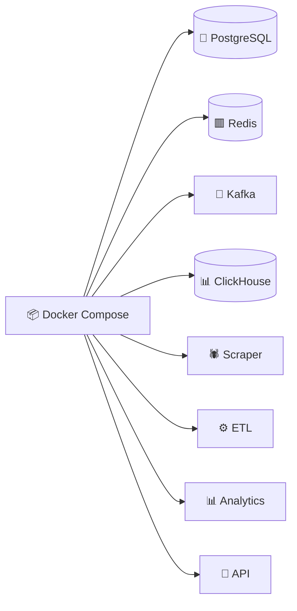

---

## Definition of Done

- [ ] docker compose up works
- [ ] All services healthy
- [ ] Volumes configured
- [ ] Environment variables documented

---

# Phase 17 — Future Improvements

## Version 0.2

- Habr parser
- RemoteOK parser
- Better analytics

---

## Version 0.3

- Authentication
- User accounts
- Saved filters

---

## Version 0.4

- Recommendation engine

- ML salary prediction

- Skill clustering

---

## Version 1.0

Production Ready

Features

- monitoring

- CI/CD

- documentation

- testing

- dashboard

- analytics

---

# Release Roadmap

| Version | Goal |
|-----------|------|
| v0.1 | Infrastructure |
| v0.2 | Scraper |
| v0.3 | ETL |
| v0.4 | Analytics |
| v0.5 | REST API |
| v0.6 | Dashboard |
| v0.7 | Monitoring |
| v0.8 | Testing |
| v0.9 | CI/CD |
| v1.0 | Production Ready |

---

# Final Project Checklist

## Infrastructure

- [ ] Docker Compose
- [ ] PostgreSQL
- [ ] Redis
- [ ] Kafka
- [ ] ClickHouse
- [ ] Prometheus
- [ ] Grafana

---

## Backend

- [ ] Shared Library
- [ ] Scraper
- [ ] ETL
- [ ] Analytics
- [ ] API
- [ ] Scheduler

---

## Databases

- [ ] PostgreSQL schema
- [ ] Alembic migrations
- [ ] ClickHouse schema
- [ ] Indexes

---

## Event Streaming

- [ ] Kafka Topics
- [ ] Producer
- [ ] Consumer
- [ ] Retry Policy
- [ ] Dead Letter Queue

---

## Quality

- [ ] Ruff
- [ ] Black
- [ ] MyPy
- [ ] Pytest
- [ ] Coverage

---

## Documentation

- [ ] README
- [ ] Architecture
- [ ] ER Diagram
- [ ] API Docs
- [ ] Roadmap

---

## Observability

- [ ] Metrics
- [ ] Logs
- [ ] Dashboards
- [ ] Health Checks

---

# Success Criteria

The project is considered complete when:

- Every service runs in Docker Compose.
- The scraper collects real vacancy data.
- ETL transforms and validates events.
- PostgreSQL stores normalized entities.
- ClickHouse stores analytical datasets.
- Analytics generates business metrics.
- REST API exposes reports.
- Dashboard visualizes the data.
- Monitoring provides full observability.
- CI/CD validates every commit.
- Documentation is complete and up to date.

---

# Conclusion

This roadmap defines the complete implementation plan for the **Job Market Analyzer** platform.

By following these phases sequentially, the project evolves from an empty repository into a production-inspired microservices platform demonstrating modern backend engineering, data engineering, event-driven architecture, analytics, observability and DevOps practices.
